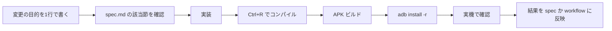

# 開発ワークフロー

- 版: 0.2（2026-10-13）
- 仕様: [spec.md](spec.md)
- 対象: Unity 2022.3.62f3 / RayNeo X3 Pro（ARGF20）/ Windows

---

## 1. 守る前提（現行 APK）

次を崩すと、アプリや仮想アプリごと落ちる。変更するときは、別 APK で先に検証する。

- `Assets/Gude.unity` のみをビルドする（`Assets/Scenes/PoCTest.unity` は入れない）
- Manifest: `com.rayneo.mercury.app=true`、`singleTask`、`AR_APP`。`ar_mode` を付けない
- OpenXR loader の AAR は Exclude Android。XR の `InitManagerOnStart` は 0
- `git commit` は、依頼があるまで行わない

---

## 2. 役割分担（モデル）

| 工程 | 向く担当 | 理由 |
|---|---|---|
| 仕様の見直し・設計・やる／やらないの判断 | Claude Sonnet 5.5（Ask モード推奨） | 文章で境界を切る作業 |
| Unity / adb / 実機ループの実装 | 実機に触れるエージェント（Agent モード） | ビルドとログで確かめる作業 |
| レビュー | 別セッション（Ask） | 実装と切り分ける |

これはベンチマークではなく運用上の目安。作業の種類で切り替える。

**切り替えの手順**
1. 同じチャットでモデルを切り替えるだけでよい（履歴は引き継がれる）。
2. 新規チャットなら、`docs/spec.md` を渡し、「コードは書かない」と明記する（仕様用）。
3. Agent に戻すときは、変更したい節（例: `spec.md §4.5`）を指定する。

---

## 3. 日常ループ（ガイドモードの変更）



### 3.1 手順

1. **目的を 1 行で書く**（例: 「進行保存を入れる」）。仕様の節番号を付ける。
2. **実装**。1 回の変更は、実機で 1 つ確かめられる単位に収める。
3. **Unity を前面にして `Ctrl+R`** でスクリプトを再コンパイルする（バックグラウンドだと検出が遅れる）。
4. **コンパイルエラーを先に潰す**（下記 §3.2）。
5. **ビルドのトリガー**: `Temp/request-android-device-build` を作る。ステータスは `Temp/android-device-build-status.txt`。
6. **インストール**: `adb install -r Builds\WorkGuidance.apk`。
7. **実機で確認**し、受け入れ基準（spec §8）に照らして記録する。

### 3.2 ビルドが `failed: Unknown` のとき

`BuildResult.Unknown` は、**コンパイルエラー残り**で出ることが多い。

1. `%LOCALAPPDATA%\Unity\Editor\Editor.log` の末尾付近で `error CS` を探す。
2. 直したら、Unity を前面にして `Ctrl+R`。
3. `AndroidDeviceBuild` は、コンパイルエラー時に `failed: compile errors` を書いて中止する（トリガー後に最大 4 秒待つ）。

### 3.3 よく使う実機コマンド（PowerShell）

adb は PATH にない。次を使う。

```powershell
$adb = "$env:LOCALAPPDATA\Android\Sdk\platform-tools\adb.exe"
& $adb devices -l
& $adb install -r "C:\Users\ohnum\FixLensAR\Builds\WorkGuidance.apk"
& $adb logcat -s Unity:V
```

- 想定デバイス: `006A5E505B6A290`（ARGF20）。
- Unity のウィンドウが前面でないと、ビルドのトリガーが `queued` のまま止まることがある。

---

## 4. 実機確認チェックリスト（ガイドモード）

変更のたびに、該当項目だけでよい。リリース前は全項目。

| 区分 | 確認 |
|---|---|
| 起動 | アプリ一覧から 1 回で起動する。再起動で UI が二重にならない。仮想アプリ扱いにならない |
| 表示 | 左右それぞれに 3 段が出る。上は番号、中は指示、下はヒント |
| 音声 | 「次へ」「戻る」「もう一度」が反応する。「了解：…」が出る |
| 原点 | 2 秒静止で記録できる。アルバムに白黒画像が出る |
| 緑枠 | 右を向くと枠が左へ、下を向くと上へ。範囲外で消え、戻ると出る |
| 失敗時 | カメラ権限なし、暗い、で止まらない |
| 進行 | （実装後）強制終了後に続きから再開できる |

---

## 5. 検証タスク（先にやる・別 APK）

仕様の「要検証」を潰す。**現行 APK を触らない**。

| ID | 内容 | 方法 | 成果物 |
|---|---|---|---|
| V1 | SLAM 中に眼鏡カメラが使えるか | 別プロジェクトで標準 SLAM サンプル + 撮影を同時に試す | 可否と手順を spec §2.1 に追記 |
| V2 | loader の何が SIGSEGV か | (a) `.so` のみ同梱 / (b) 標準サンプルそのまま、の 2 パターン。ログを保存 | 原因の切り分けを spec §2.1 に追記 |
| V3 | 白黒魚眼で合否判定ができるか | 同じ作業の「合・否」を数枚撮り、PC で人が見て区別できるか | 判定できる誤りの一覧 |
| V4 | RGB を loader なしで取れるか | Camera2 等を、現行 APK のコピーで試す | 取得経路の可否 |
| V5 | シーン往復の安定性 | 3DoF → 6DoF → 戻る を数回 | 往復の可否 |

**進め方**
1. 検証用に別の Unity プロジェクトを作る（本リポジトリと分ける）。
2. 結果は日付付きで、このファイル末尾の「検証ログ」に 1 行ずつ残す。
3. V1〜V5 の結論が出るまで、確認モードと空間モードの実装を始めない。

---

## 6. 開発フェーズ

| フェーズ | 内容 | 完了条件 |
|---|---|---|
| **P0** | 仕様の確定（本書）と、検証 V1〜V5 | 未決事項（spec §10）に判断が付く |
| **P1** | 進行保存、`wait` タイマー、「最初から／続きから」 | spec §8 の進行保存が満たされる |
| **P2** | JSON v2、PC ビューア、図パネル | 1 キット分を v2 で通しで進められる |
| **P3** | 音声の誤進行対策、失敗時の表示 | 作業音ありで誤進行 0 |
| **P4** | 確認（V3・V4 の結果次第） | 検出対象を絞った確認が動く |
| **P5** | 空間モード（別 APK） | SLAM が成功し、印が机に残る |
| **P6** | 統合の判断 | 1 APK / 2 APK を決める |

P1〜P3 は、空間の結論を待たずに進められる。

---

## 7. 変更管理

- 仕様の変更は `docs/spec.md` を先に直し、その節番号を作業ログに書く。
- 実機で分かったことは、この資料の「検証ログ」と、エージェント記憶（`work-guidance-companion.md`）の両方に要点だけ反映する。
- 禁止事項に触れる変更（loader、`ar_mode` など）は、実装前に別 APK での検証結果を添える。
- `git commit` は依頼があるまで行わない。

---

## 8. 引き継ぎ用の定型文（Sonnet などへ）

```
コードは書かない。docs/spec.md と docs/workflow.md を読み、
次の節について、指摘と修正案だけを出す: <節番号>
制約: 現行 APK に OpenXR loader / ar_mode / XR Plugin を足す案は出さない。
```

---

## 検証ログ

| 日付 | ID | 結果 | メモ |
|---|---|---|---|
| 2026-10-13 | — | 現行 APK で `EnableSlamHeadTracker` を呼ぶと `libRayNeoXRApiLayerClient.so` が見つからず `dlopen` 失敗。アプリは落ちない | V2 の途中経過 |
| 2026-10-13 | — | 緑枠: カメラ SAD を主表示にすると遅延し、上下が逆。ジャイロ主 + 弱い補正で改善 | spec §4.4 に反映済み |
| 2026-10-13 | — | 緑枠: クランプで枠の一部が端に残った。範囲外で消す方式に変更 | spec §4.4 に反映済み |
| 2026-10-13 | P1 | 進行保存・wait・「続きから／最初から」を現行 APK に実装 | spec §4.5 |
